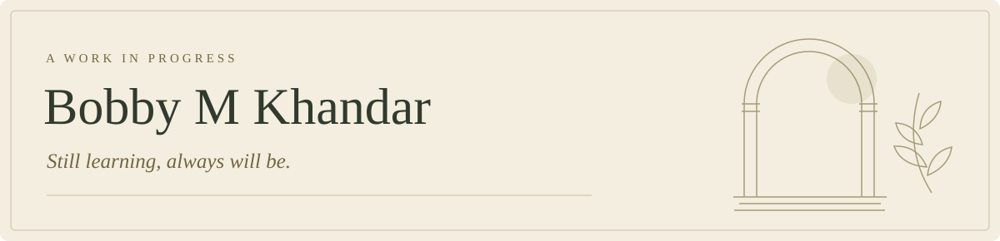

<picture>
  <source media="(prefers-color-scheme: dark)" srcset="assets/header-dark.svg">
  
</picture>

I build things I need, share what I learn, and mess around with whatever interests me.

Web tools, data pipelines, and AI experiments are some of the things you'll find here.

### Things I reach for

<!-- tech-stack:start -->

More libraries & tools

**AI & data**

**Backends & services**

**Application libraries**

**Build & testing**

**Documents & formats**

**Interface libraries**

**Small utilities**

<!-- tech-stack:end -->

<!--
The GitHub Action scans public repositories and combines the results with a curated
package list from private projects. Python is intentionally always included. These
badges reflect project usage, not a claim that every dependency is a personal skill.
-->

